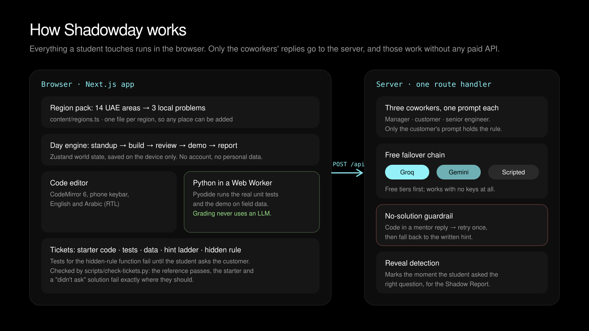
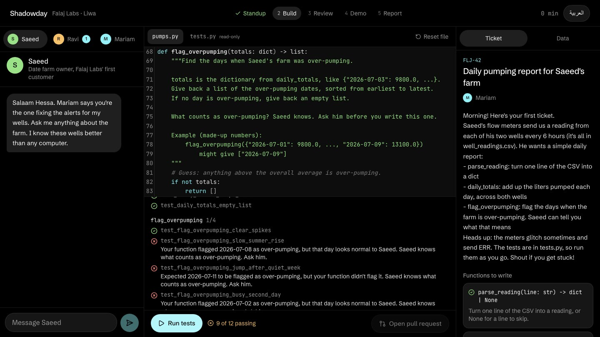
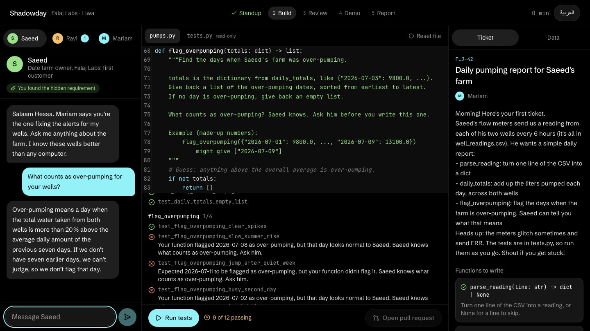
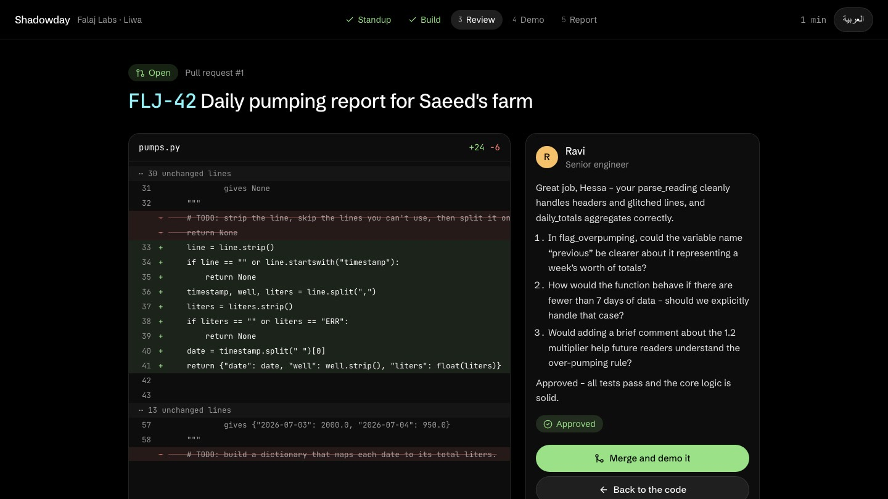
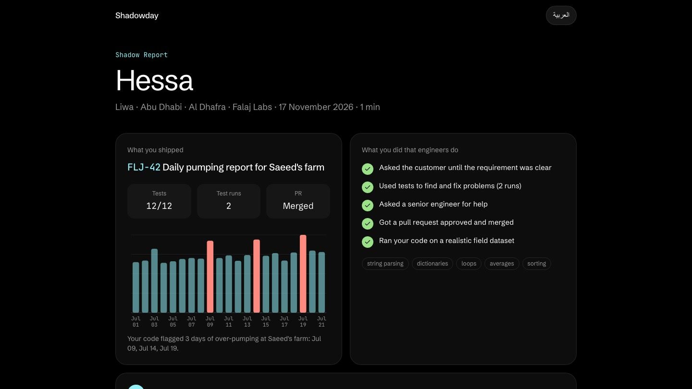
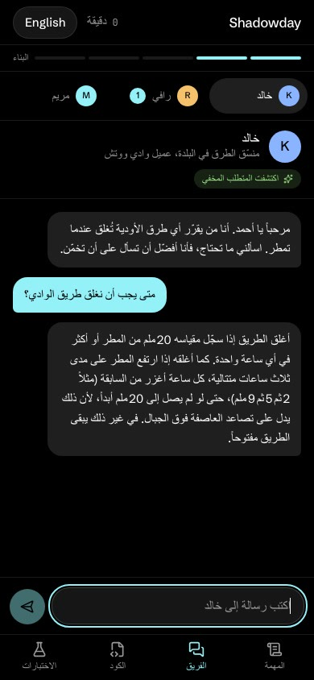

# Shadowday

**A first day at a tech job, from anywhere in the UAE.**

Shadowday is a free browser simulation for secondary-school students. You pick where you live, join a (fictional) startup working on a real problem near you, and spend a day as its newest engineer: a standup, a ticket, real Python, real tests, a code review, a demo, and a report you can keep.

Built solo for [Bridge The Gap Hacks](https://sq-hacks.devpost.com) (Nov 15–20, 2026), whose tagline is *"Innovation shouldn't depend on location."*

- **Live app:** _add the Vercel URL here_
- **Demo video:** _add the YouTube link here_



| | |
|---|---|
|  |  |
|  |  |

<p align="center"></p>

## Why

- Since the 2025–26 school year, AI has been a required subject in every UAE public school, from kindergarten to Grade 12 ([WAM](https://www.wam.ae/en/article/15qfeob-national-identity-shape-uae’s-2025–2026-academic)).
- The places where students could *see* tech work are concentrated: 99% of UAE tech funding in January–September 2026 went to companies in Dubai (69%) and Abu Dhabi (30%) (Tracxn, *UAE Tech 9M 2026* report, via [Zawya](https://www.zawya.com/en/press-release/companies-news/moove-cargo-x-and-tabby-raise-733mln-combined-accounting-for-49-of-uae-techs-1.5bln-in-9m-2026-1857288)).
- Research on inventors finds that childhood *exposure* to innovation shapes who becomes an inventor (Bell, Chetty, Jaravel, Petkova & Van Reenen, *Who Becomes an Inventor in America?*, QJE 2019).

A student in Liwa, Dibba or Kalba learns AI in class but rarely sees what an engineer's day looks like. Shadowday lets them live one.

## The day

| Step | What happens |
|---|---|
| **Pick your area** | 14 areas across all seven emirates. Each maps to a local problem: date-farm groundwater (Falaj Labs), wadi flash floods (WadiWatch) or outdoor-worker heat safety (Barid Labs). |
| **Standup** | Mariam, the engineering manager, introduces the team and hands you a ticket. |
| **Build** | Three small Python functions, with unit tests that run in your browser. One function depends on a rule nobody wrote down: the tests fail until you ask the customer (Saeed, Khalid or Fatima). |
| **Ask for help** | Ravi, the senior engineer, answers questions with questions and gives hints in steps. He will not write your code. |
| **Pull request** | Ravi reviews your actual diff and approves it when the tests pass. |
| **Demo** | Your code runs on the field data and the results are charted for Mariam. |
| **Shadow Report** | What you shipped, what you did that engineers do, Mariam's note, free next steps, and a .zip of your project with a README and test runner. |

English and Arabic (full right-to-left), phone and laptop, no account, nothing stored except on your device.

## How it works

- **Python in the browser.** [Pyodide](https://pyodide.org) runs in a module Web Worker, served from the app's own origin. A small harness (`public/py/harness.py`) runs the tests and the demo and returns structured results. Grading is real tests, never an LLM's opinion. Infinite loops are stopped after 10 seconds by terminating the worker.
- **Three AI coworkers, $0.** `POST /api/agent` builds a prompt per coworker and tries **Groq's free tier**, then **Gemini's free tier**, then a **scripted fallback** written for every coworker, mode and language. With no API keys the whole day still works.
- **The hidden requirement.** Only the customer's prompt contains the rule. Unit tests prove the mentor's and manager's prompts never do. A reply that states the rule is detected and marks the moment for the report.
- **No-solution guardrail.** A mentor reply that contains code is rejected and retried once; if it happens again, the written hint for that step is used.
- **Region packs.** `content/regions.ts` maps areas to problems, companies and people. A new region is one more file shaped like it.
- **Tickets are checked.** `scripts/check-tickets.py` proves each reference solution passes, each starter fails, and a "didn't ask the customer" solution fails exactly on the hidden-rule tests.

## Run it locally

```bash
npm install
cp .env.example .env.local   # optional: add free Groq / Gemini keys
npm run dev                  # http://localhost:3000
```

Free keys: [console.groq.com/keys](https://console.groq.com/keys) and [aistudio.google.com/apikey](https://aistudio.google.com/apikey). Leave them empty to use the scripted coworkers.

## Tests

```bash
npm test                          # 240 unit tests: failover, guardrails, prompts, reveal detection, scripted replies, route
python3 -I scripts/check-tickets.py   # ticket integrity
npx playwright test               # end-to-end on desktop Chromium, Pixel 7 and iPhone 15 (needs the dev server)
```

## Demo video

The video is generated from the real app: `video/record.mjs` drives the day in headless Chrome with the live AI coworkers and records it with Chrome's screencast, and `video/build.mjs` adds the narration (macOS `say`), burned-in captions and the title cards with ffmpeg.

```bash
node video/build.mjs audio     # narration from video/narration.json
node video/record.mjs          # footage (needs the dev server on :3000)
node video/build.mjs video     # demo/shadowday-demo.mp4 + .srt
```

## Project map

```
app/            start, day, report pages and the /api/agent route
components/     workspace panes, standup, review, demo
content/        regions.ts (UAE region pack), tickets/<id>/ sources, dayScript.ts
lib/agents      prompts, guardrails, reveal detection, runAgent
lib/llm         Groq and Gemini providers, failover, rate limit, scripted replies
lib/runner      Pyodide worker client
public/py       test harness
public/index.html, public/assets   landing page
```

## Honest notes

- Falaj Labs, WadiWatch and Barid Labs, and every person in the simulation, are fictional. The datasets are realistic but made up.
- The coworkers are AI. They can be wrong; the tests are the source of truth.
- Statistics above are quoted from the linked sources.

## Credits

Pyodide, CodeMirror, Next.js, Zustand, fflate, lucide icons. Fonts: Schibsted Grotesk, JetBrains Mono, IBM Plex Sans Arabic.
